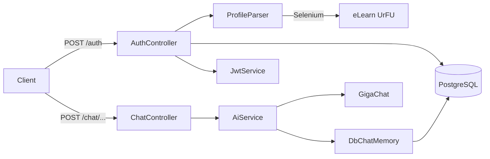

<div align="center">


</div>

## О проекте

**Student Urfu Helper** — backend-сервис для студентов УрФУ, который помогает выстраивать индивидуальную образовательную траекторию.

Сервис авторизуется в eLearn УрФУ, получает профиль студента, сохраняет данные в PostgreSQL и предоставляет AI-ассистента на GigaChat с историей диалога.

## Как это работает



1. Студент отправляет логин и пароль eLearn на `POST /auth`.
2. `ProfileParser` открывает eLearn через Selenium, логинится и парсит профиль: ФИО, часовой пояс, статус обучения, группу, номер студента и карточки курсов.
3. Студент сохраняется в PostgreSQL; пароль хранится только в виде BCrypt-хеша.
4. В ответ возвращается JWT и данные профиля.
5. Запросы в чат уходят в GigaChat с системным промптом и историей диалога из БД.
6. Ответы стримятся клиенту через SSE.

## Возможности

- Авторизация через eLearn УрФУ с парсингом профиля студента.
- JWT-токены и компоненты Spring Security.
- PostgreSQL и Spring Data JPA/Hibernate.
- AI-ассистент на GigaChat с системным промптом для планирования образовательной траектории.
- История чатов в БД через кастомный `ChatMemory`.
- Потоковые ответы через SSE (`Flux<String>`).
- DTO и маппинг через MapStruct.
- BCrypt, CORS, Log4j2 и Docker Compose для PostgreSQL.
- Maven Wrapper.

## Стек

| Компонент | Версия | Назначение |
|:---|:---|:---|
| Java | 24 | Язык |
| Spring Boot | 3.5.7 | Основа приложения |
| Spring Web + WebFlux | Spring Boot 3.5.7 | REST, reactive-контроллеры, SSE |
| Spring Security | Spring Boot 3.5.7 | Аутентификация и защита |
| JJWT | 0.12.7 | JWT-токены |
| Spring Data JPA / Hibernate | Spring Boot 3.5.7 | Работа с PostgreSQL |
| PostgreSQL | — | Основная БД |
| Spring AI + GigaChat | 1.0.6 | LLM-ассистент |
| MapStruct | 1.6.3 | Маппинг DTO |
| Lombok | — | Сокращение boilerplate |
| Selenium | 4.38.0 | Парсинг eLearn УрФУ |
| WebDriverManager | 5.6.2 | Управление ChromeDriver |
| Log4j2 | Spring Boot 3.5.7 | Логирование |
| Maven Wrapper | — | Сборка |
| Docker Compose | — | PostgreSQL для разработки |

## Структура проекта

```text
src/main/java/urfu/student/helper/
├── ai/              # ChatClient, GigaChat, инструменты, ChatMemory
├── controllers/     # Auth, Chat, Student
├── db/              # Entity, Repository, Service, DTO, MapStruct
├── parser/          # Selenium-парсеры eLearn УрФУ
├── security/        # JWT, reactive auth, CORS, конфиг UrFU API
└── HelperApplication.java

src/main/resources/
├── application.yaml
├── system_prompt.txt
└── log4j2.xml

compose.yaml         # PostgreSQL для локального запуска
```

## HTTP API

| Метод | Путь | Описание |
|:---|:---|:---|
| `POST` | `/auth` | Логин в eLearn, парсинг профиля, сохранение студента, выдача JWT |
| `GET` | `/chat/{chatId}` | Получить чат |
| `DELETE` | `/chat/{chatId}` | Удалить чат |
| `POST` | `/chat/{chatId}/message` | Отправить сообщение в существующий чат, SSE-стрим |
| `POST` | `/chat/chat/new/message` | Создать чат и отправить первое сообщение, SSE-стрим |
| `GET` | `/chats` | Список чатов текущего студента |

## Конфигурация

Секреты задаются через переменные окружения.

| Переменная | Назначение |
|:---|:---|
| `DATABASE_URL` | JDBC URL PostgreSQL |
| `DATABASE_USERNAME` | Пользователь БД |
| `DATABASE_PASSWORD` | Пароль БД |
| `GIGACHAT_CLIENT_ID` | Client ID GigaChat |
| `GIGACHAT_CLIENT_SECRET` | Client Secret GigaChat |
| `MODEL_NAME` | Модель GigaChat |
| `JWT_SECRET` | Секрет для подписи JWT |
| `APPLICATION_PORT` | Порт приложения |
| `TEST_MODE` | Опционально: отключает SQL-логи и unsafe SSL |

## Запуск локально

Требования:

- JDK 24;
- PostgreSQL;
- Google Chrome или Chromium для Selenium;
- Maven Wrapper из репозитория.

```bash
git clone https://github.com/StefanParmezan/Student-Urfu-Helper.git
cd Student-Urfu-Helper
docker compose up -d
```

Экспортировать переменные окружения:

```bash
export DATABASE_URL="jdbc:postgresql://localhost:5432/mydatabase"
export DATABASE_USERNAME="myuser"
export DATABASE_PASSWORD="secret"
export GIGACHAT_CLIENT_ID="..."
export GIGACHAT_CLIENT_SECRET="..."
export MODEL_NAME="GigaChat"
export JWT_SECRET="change-me-to-a-long-random-string"
export APPLICATION_PORT="8080"
```

Запустить приложение:

```bash
./mvnw spring-boot:run
```

Сборка и запуск jar:

```bash
./mvnw clean package
java -jar target/helper-0.0.1-SNAPSHOT.jar
```

На Windows используйте `mvnw.cmd`.

## Безопасность

- Сырой пароль eLearn не сохраняется: в БД пишется только BCrypt-хеш.
- `JWT_SECRET` должен быть длинным случайным значением и храниться вне репозитория.
- Доступы к PostgreSQL и GigaChat передаются через переменные окружения.

## Автор

[StefanParmezan](https://github.com/StefanParmezan)

- GitHub: [StefanParmezan/Student-Urfu-Helper](https://github.com/StefanParmezan/Student-Urfu-Helper)
- Telegram: [@StefanParmezan](https://t.me/StefanParmezan)
